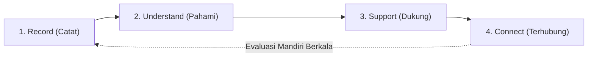

# EMODIARY 🌿
> **Platform Digital Konseling dan Layanan Dukungan Psikologis Terintegrasi Berbasis Artificial Intelligence Beretika**  
> *Inovasi Kesehatan Mental Mahasiswa — Universitas 17 Agustus 1945 Surabaya (Untag Surabaya) 2026*

---

## 📌 Latar Belakang & Urgensi
Berdasarkan data **Survei Kesehatan Indonesia (SKI 2023)**, prevalensi depresi pada kelompok usia remaja dan dewasa muda (15–24 tahun) mencapai **2,0%**. Namun, dari angka tersebut, hanya **10,4%** yang mengakses layanan bantuan profesional. Sebanyak **89,6%** generasi muda berjuang dalam isolasi akibat:
1. **Stigma sosial** dan rasa malu untuk bercerita.
2. **Keterbatasan biaya** dan akses psikolog profesional.
3. **Keterlambatan deteksi dini**, di mana kelelahan mental baru disadari setelah mencapai tahap krisis akademik atau depresi berat.

**EMODIARY** hadir sebagai jembatan mandiri yang menghubungkan pemantauan kesehatan emosional harian dengan layanan bimbingan konseling kampus resmi secara etis dan aman.

---

## 🔄 Alur Terpadu 4 Langkah (*The Continuous Loop*)
EMODIARY menerapkan siklus pendampingan berkelanjutan **Record → Understand → Support → Connect**:



### 1. 📝 Record (Catat Perasaan)
- **Mood Diary Multimodal:** Pencatatan afektif mandiri dengan pilihan spektrum 5 emosi (*Kewalahan, Lelah, Biasa Saja, Tenang, Sangat Baik*).
- **Dual-Mode Journaling:** Mendukung pencatatan melalui teks dan rekaman suara (*Voice Note*) dengan visualisasi gelombang suara (*real-time audio waveform*) dan transkripsi lokal.
- **Konteks & Durasi Tidur:** Pelacakan faktor pemicu stres (*Skripsi, Kurang Tidur, Beban Akademik, Ekspektasi Keluarga*) dan jam istirahat.

### 2. 📊 Understand (Pahami Pola Perasaan)
- **Grafik Perjalanan Mood Mingguan (*Weekly Mood Journey*):** Visualisasi trajektori fluktuasi skor mood 7 hari interaktif menggunakan kurva Bezier SVG.
- **Deteksi Dini Kelelahan Berlanjut:** Indikator otomatis yang memberi peringatan ramah bila skor emosi tertekan bertahan lebih dari 4 hari berturut-turut.
- **Analisis Korelasi Pola:** Mengidentifikasi hubungan antara waktu pencatatan larut malam (pukul 23:00–02:30 WIB), defisit jam tidur, dan kecemasan tugas akhir.

### 3. 💬 Support (Teman Refleksi & Relaksasi)
- **Teman Refleksi Ceritamu (*Reflective Companion*):** Dialog reflektif berlandaskan metode *Cognitive Behavioral Therapy (CBT)* Socratic untuk membantu mahasiswa mengurai pikiran buntu dan merumuskan langkah kecil (*micro-stepping*).
- **Latihan Relaksasi Somatik 4-7-8:** Panduan pernapasan interaktif terverifikasi untuk meredakan detak jantung cepat, ketegangan dada, dan kecemasan akut.
- **Modul Psikoedukasi Praktis:** Panduan ringkas mengatasi *catastrophizing*, pentingnya ritme sirkadian tidur, dan tips menghadapi revisi dosen.

### 4. 🤝 Connect (Bantuan Konselor & Psikolog)
- **Rujukan Konseling Kampus Untag Surabaya:** Akses langsung ke Pusat Layanan Bimbingan & Konseling Universitas 17 Agustus 1945 Surabaya (Gedung Graha Wiyata Lt. 2) yang bebas biaya bagi mahasiswa aktif.
- **Lembar Ringkasan Klinis 1 Halaman (*Consent-First*):** Mahasiswa memiliki hak penuh memilih data grafik dan pemicu stres yang ingin dibagikan ke psikolog, **tanpa pernah membocorkan isi tulisan buku harian privatnya**.
- **Akses Tanggap Krisis 24 Jam:** Integrasi hotline darurat kesehatan jiwa bebas pulsa LISA / Kemenkes 119 (Tekan 8).

---

## 🛡️ Tata Kelola Etika AI & Kedaulatan Privasi (WHO 2021)
Aplikasi ini dibangun dengan kepatuhan ketat terhadap **WHO Guidance on Ethics & Governance of AI for Health (2021)** serta **UU Perlindungan Data Pribadi (UU PDP No. 27 Tahun 2022)**:
- **Non-Diagnostik:** AI dirancang sebagai fasilitator refleksi mandiri, bukan pengganti diagnosis medis dokter atau psikolog klinis.
- **Kerahasiaan Sisi Klien (*On-Device Privacy*):** Catatan harian dan transkripsi suara diproses di peramban pengguna dan tidak digunakan untuk melatih model pihak ketiga (*Zero Training Policy*).
- **Persetujuan Granular (*Explicit Consent*):** Catatan curhat pribadi tetap terkunci; hanya ringkasan metrik yang diizinkan mahasiswa yang dapat dicetak untuk sesi konseling.

---

## 💻 Teknologi yang Digunakan (*Tech Stack*)
- **Frontend Framework:** React 19 (TypeScript)
- **Build Tool:** Vite 8
- **Styling:** Tailwind CSS v4 (Desain Minimalis Modern & Responsif)
- **Ikonografi:** Lucide React
- **Efek & Animasi:** Canvas Confetti & Transisi Halus CSS
- **Visualisasi Data:** Custom Lightweight Bezier SVG Curve (Tanpa dependensi berat)

---

## 🚀 Panduan Menjalankan Proyek (*Quick Start*)

### Prasyarat
- Node.js (versi 18 atau lebih baru)
- npm, pnpm, atau yarn

### Langkah Instalasi
```bash
# 1. Clone repositori ini
git clone https://github.com/FadliBilal/emodiary.git

# 2. Masuk ke direktori proyek
cd emodiary

# 3. Pasang seluruh dependensi
npm install

# 4. Jalankan server pengembangan lokal
npm run dev
```

Buka peramban Anda di alamat yang tertera (biasanya `http://localhost:5173/` atau `http://localhost:5174/`).

### Perintah Build Produksi
```bash
# Verifikasi tipe TypeScript dan kompilasi bundle produksi
npm run build

# Menjalankan pratinjau hasil build
npm run preview
```

---

## 👥 Tim Pengembang & Peneliti
**Universitas 17 Agustus 1945 Surabaya (Untag Surabaya)**
- **Inka Sukma Melati** — Desain Produk & Alur Pengguna
- **Linda Anas Tasya Oktaviani** — Riset Etika Psikologi & Panduan Relaksasi
- **Nauvan Toriq Dwi Putrantoko** — Pengembangan Sistem & Analitik Mood
- **Arinil Hidayah Burhanuddin** — Tata Kelola Data & Kerahasiaan Pengguna

---

## 📄 Lisensi
Hak Cipta © 2026 Tim EMODIARY — Universitas 17 Agustus 1945 Surabaya.  
Dikembangkan untuk kompetisi inovasi kesehatan digital 2026.
